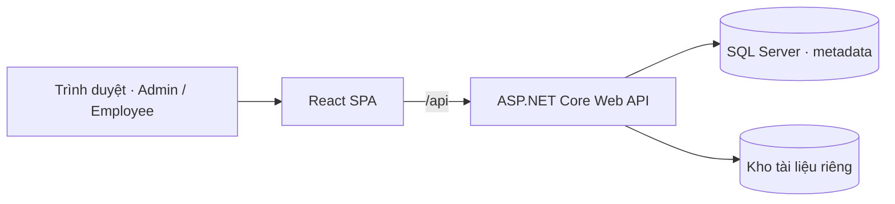

# IT Management · IT Desk

**Đồ án quản lý tài sản CNTT và mô phỏng môi trường làm việc của nhân viên.**

**Trạng thái · Hoàn thành phạm vi đồ án ngày 26/11/2026.**

IT Desk giúp doanh nghiệp quản lý thiết bị, tài khoản, phần mềm và tài liệu trên các máy dùng chung. Admin quản lý tài sản và cấu hình máy. Employee chọn máy trên trình duyệt, đăng nhập một lần và làm việc trong Desktop/Documents của mình.

Giao diện sử dụng nhận diện STU, tông xanh dương và nền trắng. Cả cổng Admin và Employee cùng thuộc một ứng dụng React.

- [Chức năng và phân quyền](#chức-năng-và-phân-quyền)
- [Quy tắc nghiệp vụ](#quy-tắc-nghiệp-vụ)
- [Công nghệ và kiến trúc](#công-nghệ-và-kiến-trúc)
- [Cài đặt và chạy](#cài-đặt-và-chạy)
- [Kiểm thử](#kiểm-thử)
- [Vận hành và sao lưu](#vận-hành-và-sao-lưu)
- [Tài liệu tham khảo](#tài-liệu-tham-khảo)

## Chức năng và phân quyền

| Phân hệ | Khả năng đã triển khai |
| --- | --- |
| Tài sản | Admin tạo và cập nhật thiết bị, quản lý trạng thái, vị trí, thông tin người chịu trách nhiệm và lịch sử bàn giao/trả máy. |
| Tài khoản | Admin tạo, khóa, mở khóa và reset mật khẩu Employee. Nhân viên xem thông tin tài khoản và chủ động đổi mật khẩu. |
| Máy mô phỏng | Nhân viên chọn máy, đăng nhập, xem cấu hình, phần mềm và làm việc với tài liệu trong cùng một phiên. |
| Tài liệu | Tạo và sửa TXT/CSV, nhập tài liệu Office/PDF, đọc hoặc tải xuống, đổi tên, di chuyển, sao chép, đưa vào thùng rác và khôi phục. |
| Quota tài khoản | Admin xem tổng số file của nhân viên trên tất cả máy, số file theo từng máy và điều chỉnh một hạn mức chung. |
| Phần mềm | Admin khai báo App/Service từng mục hoặc hàng loạt cho một hay nhiều máy. Nhân viên xem danh sách và gửi yêu cầu xóa có Admin xác nhận tại máy. |
| Nhật ký Admin | Tra cứu lịch sử thay đổi file theo thời gian, người thực hiện và loại thao tác. |
| Metadata Admin | Tra cứu tên, phần mở rộng, thư mục, dung lượng, chủ sở hữu, máy và loại kho lưu trữ của file. |
| Yêu cầu hỗ trợ | Employee gửi và theo dõi ticket của mình. Admin xử lý, trao đổi, thêm ghi chú nội bộ và cập nhật trạng thái. |

### Luồng Employee

```text
Mở website → Chọn máy → Đăng nhập tài khoản Employee
                              ↓
                  Desktop/Documents của mình
                       ├── Chi tiết máy và lịch sử file
                       ├── Danh sách phần mềm
                       ├── Thông tin tài khoản, đổi mật khẩu
                       └── Yêu cầu hỗ trợ
                              ↓
                 Đăng xuất → Đăng nhập lại cùng máy
                              └── Chọn máy khác
```

Đường dẫn gốc `/` đưa người dùng đến `/employee`. Trang đăng nhập hiển thị tên và mã của máy đã chọn. Mọi Employee đang hoạt động được sử dụng các máy Desktop, Laptop và Server ở trạng thái **Sẵn sàng** hoặc **Đã bàn giao**.

### Cổng Admin

Admin đăng nhập trực tiếp tại `/admin`. Giao diện sử dụng nền navy và thẻ đăng nhập trắng. API kiểm tra vai trò cho từng chức năng quản trị.

| Đường dẫn | Nội dung |
| --- | --- |
| `/employee` | Chọn máy trước khi đăng nhập |
| `/machines/{id}/login` | Đăng nhập vào máy đã chọn |
| `/machines/{id}/desktop` | Desktop/Documents, chi tiết và phần mềm của máy |
| `/employee/tickets` | Yêu cầu hỗ trợ của nhân viên |
| `/admin` | Đăng nhập và tổng quan quản trị |
| `/admin/assets` | Tài sản, bàn giao và cấu hình mô phỏng |
| `/admin/users` | Tài khoản nhân viên |
| `/admin/quotas` | Quota tài khoản |
| `/admin/audit-log` | Nhật ký thao tác file |
| `/admin/files-admin` | Metadata file |
| `/admin/tickets` | Xử lý yêu cầu hỗ trợ |

## Quy tắc nghiệp vụ

### Bàn giao thiết bị và phiên làm việc

Bàn giao ghi nhận người chịu trách nhiệm về tài sản. Quyền sử dụng máy mô phỏng được xác định theo trạng thái tài khoản và thiết bị.

Mỗi máy có tối đa một phiên đang sử dụng hợp lệ. F5 khôi phục đúng Desktop khi phiên và quyền truy cập còn hiệu lực. Khi tab gửi tín hiệu rời trang, máy chủ dành **60 giây** để người dùng quay lại trước khi giải phóng máy. Đổi tab hoặc thu nhỏ cửa sổ vẫn giữ phiên. Nếu tín hiệu rời trang chưa được gửi, phiên tiếp tục chịu hạn gốc tối đa **8 giờ**.

Bấm **Đăng xuất** kết thúc phiên ngay và đưa nhân viên về trang đăng nhập của cùng máy. Nhân viên có thể chọn **Chọn máy khác** tại đây.

### Quyền xem và thao tác file

| Khu vực | Phạm vi hiển thị và quyền sử dụng |
| --- | --- |
| Desktop/Documents, thùng rác | File của người đang đăng nhập trên đúng máy đó. Người dùng có thể thao tác với tài liệu của mình. |
| Chi tiết máy | Thông tin cấu hình và bảng chỉ đọc về file, chủ sở hữu, lịch sử thay đổi của những người đã dùng máy hiện tại. |
| Metadata Admin | Thông tin mô tả file trên các máy, có bộ lọc và phân trang. |
| Phần mềm | Danh sách App/Service của máy hiện tại. Đường dẫn cài đặt được cung cấp cho Admin. |

Tên file, phần mở rộng, thư mục, dung lượng và chủ sở hữu là dữ liệu mô tả được dùng khi tra cứu. Quyền mở, sửa hoặc tải nội dung tài liệu được kiểm tra theo **tài khoản sở hữu, máy và phiên làm việc**.

Nhật ký theo dõi bảy thao tác thành công gồm **tạo, cập nhật, đổi tên, di chuyển, sao chép, đưa vào thùng rác và khôi phục**. Sự kiện lịch sử thiếu tên file hiển thị **Chưa ghi tên**.

### Quota chung theo tài khoản

Mỗi Employee có mặc định **10 file trên tất cả máy**. File của từng máy nằm trong hồ sơ riêng của nhân viên, còn số lượng được cộng dồn cho tài khoản.

| Ví dụ với hạn mức 10 file | Đã dùng trên máy | Tổng đã dùng | Còn lại cho tài khoản |
| --- | --- | --- | --- |
| An lưu 7 file trên máy A | 7 | 7 | 3 |
| An sang máy B và lưu thêm 3 file | 3 | 10 | 0 |

- Tạo, nhập, sao chép và khôi phục cần một suất trống.
- Sửa nội dung, đổi tên và di chuyển giữ nguyên số file.
- Đưa file vào thùng rác trả lại một suất quota.
- App/Service do Admin khai báo được miễn quota tài liệu.
- Khi Admin hạ hạn mức xuống dưới số đã dùng, tài khoản ở trạng thái vượt quota. Nhân viên cần giảm số file hoặc được Admin tăng hạn mức trước khi thêm file.

Các yêu cầu ghi đồng thời được kiểm soát trong giao dịch để bảo vệ hạn mức chung giữa nhiều máy. Mã yêu cầu giúp hệ thống nhận diện thao tác gửi lại khi mạng bị gián đoạn.

### Mật khẩu Employee

Tài khoản được tạo hoặc reset qua giao diện Admin dùng mật khẩu mặc định của đồ án `12345Az@`. Employee có thể đổi tại **Thông tin tài khoản** sau khi đăng nhập máy.

| Mốc thời gian | Hành vi |
| --- | --- |
| Đăng nhập đầu tiên sau tạo/reset | Bắt đầu chu kỳ bảy ngày, hiển thị nhắc đổi mật khẩu, có thể đổi ngay hoặc bỏ qua. |
| Sau 4, 5 và 6 ngày | Nhắc lại nếu chưa đổi mật khẩu, tương ứng ngày 5, 6 và 7. |
| Đủ 7 ngày | Khóa tài khoản chưa hoàn tất đổi mật khẩu. |
| Admin mở lại tài khoản bị khóa vì quá hạn | Giữ mật khẩu hiện tại và bắt đầu chu kỳ mới từ lần đăng nhập tiếp theo. |
| Đổi mật khẩu thành công | Kết thúc chu kỳ nhắc và yêu cầu đăng nhập lại bằng mật khẩu mới. |

Bỏ qua thông báo giữ nguyên thời hạn đã bắt đầu.

### App/Service và ticket

Admin khai báo phần mềm trong **Tài sản → Cấu hình mô phỏng** hoặc **Thêm phần mềm hàng loạt**. Một lượt hỗ trợ tối đa **50 máy**, mỗi máy tối đa **200 mục**. Mục đã trùng tên và phân loại trên cùng máy được bỏ qua, kèm thống kê kết quả theo máy.

Khi Employee chọn **Yêu cầu xóa**, Admin xác nhận tài khoản ngay trong hộp thoại trên máy đó. Yêu cầu gắn với đúng máy, phần mềm, phiên Employee và phiên bản cấu hình.

Ticket đi theo trạng thái **Mở → Đang xử lý → Đã xử lý → Đóng**. Employee xem ticket của mình. Admin có thể trao đổi và ghi chú nội bộ. Phạm vi hỗ trợ của phiên bản này tập trung vào quy trình ticket giữa Employee và Admin.

## Công nghệ và kiến trúc

| Thành phần | Công nghệ |
| --- | --- |
| Giao diện | React 19, TypeScript, Vite 6, Ant Design 5 |
| API | ASP.NET Core, .NET 10 |
| Xác thực | ASP.NET Core Identity, JWT, phân quyền theo vai trò |
| Truy cập dữ liệu | Entity Framework Core 10, SQL Server |
| Database phát triển | SQL Server Express LocalDB, Windows Authentication |
| Nội dung tài liệu | Kho file riêng trên máy chủ |
| Kiểm thử | xUnit, Node.js Test Runner, Playwright với Microsoft Edge |



Backend được tổ chức thành bốn project. **Domain** chứa thực thể và quy tắc nghiệp vụ. **Application** định nghĩa hợp đồng và giao diện dịch vụ. **Infrastructure** triển khai lưu trữ, xác thực và các dịch vụ. **API** cung cấp endpoint, xác thực request và phân quyền.

```text
backend/
├── ITManagement.slnx
├── src/
│   ├── ITManagement.Domain/
│   ├── ITManagement.Application/
│   ├── ITManagement.Infrastructure/
│   └── ITManagement.API/
└── tests/
    ├── ITManagement.IntegrationTests/
    └── server_simulation_e2e.py

frontend/
└── admin/
    ├── src/
    │   ├── api/
    │   ├── pages/
    │   ├── layouts/
    │   ├── types/
    │   └── demo/
    ├── public/brand/
    └── tests/

agent/                 # Giao thức Agent và công cụ kiểm thử cũ
docs/                  # Tài liệu nghiệp vụ
legacy/                # Hướng dẫn và lịch sử luồng cũ
RUNNING.md             # Hướng dẫn môi trường và vận hành
TIEN_DO_DO_AN.md        # Tiến độ, quyết định và kết quả nghiệm thu
```

Nội dung tài liệu được lưu theo định danh máy, tài khoản và hồ sơ. SQL Server lưu tên file, thư mục, quyền sở hữu và tham chiếu đến nội dung. Kho mặc định khi chạy API từ project là `backend/src/ITManagement.API/storage/simulation`.

Cấu hình máy và App/Service do Admin khai báo phục vụ môi trường mô phỏng web. Python Agent hiện được lưu trong phần legacy. Cấu hình vận hành hiện tại sử dụng `Simulation__UseAgent=false`.

## Cài đặt và chạy

### Yêu cầu môi trường

| Công cụ | Yêu cầu |
| --- | --- |
| Hệ điều hành | Windows với SQL Server Express LocalDB |
| .NET | SDK hỗ trợ `net10.0` |
| Node.js | 22.18 trở lên để chạy cả bộ kiểm thử frontend |
| npm | Đi kèm Node.js |
| Database | Instance `(localdb)\MSSQLLocalDB`, database `ITManagement` |
| Terminal | Git Bash trong VS Code, chạy từ thư mục gốc repository |

### Database đã khởi tạo

Mở repository trong VS Code và tạo **hai terminal Git Bash**.

**Terminal thứ nhất chạy API.**

```bash
dotnet restore backend/ITManagement.slnx
dotnet run --project backend/src/ITManagement.API --launch-profile http
```

**Terminal thứ hai chạy giao diện.**

```bash
npm --prefix frontend/admin ci
npm --prefix frontend/admin run dev -- --host 127.0.0.1
```

Giữ hai terminal mở khi sử dụng. `npm ci` cần chạy khi cài đặt hoặc cập nhật dependency. Dùng **Ctrl+C** trong từng terminal để dừng dịch vụ.

| Địa chỉ | Mục đích |
| --- | --- |
| [Employee](http://127.0.0.1:5173/employee?demo=0) | Chọn máy và đăng nhập nhân viên |
| [Admin](http://127.0.0.1:5173/admin?demo=0) | Đăng nhập quản trị |
| [Swagger](http://localhost:5038/swagger) | Tra cứu API trong môi trường Development |
| [Kiểm tra kết nối](http://127.0.0.1:5173/api/machines) | Kiểm tra giao diện gọi được API và database |

### Cấu hình môi trường

API đọc cấu hình từ `appsettings.json`, `appsettings.Development.json` và biến môi trường. Đặt biến trong terminal chạy API khi cần cấu hình riêng.

| Biến | Ý nghĩa |
| --- | --- |
| `ConnectionStrings__DefaultConnection` | Chuỗi kết nối SQL Server |
| `Jwt__Secret` | Khóa ký JWT riêng, tối thiểu 32 byte |
| `Simulation__UseAgent` | `false` cho luồng mô phỏng web |
| `Simulation__StorageRoot` | Đường dẫn kho tài liệu mô phỏng |
| `Database__InitializeOnStartup` | Bật migration và seed khi khởi tạo |
| `SeedAdmin__Password` | Mật khẩu Admin khi khởi tạo database mới |

Ví dụ cấu hình kết nối LocalDB trong Git Bash.

```bash
export ConnectionStrings__DefaultConnection='Server=(localdb)\MSSQLLocalDB;Database=ITManagement;Integrated Security=True;Encrypt=True;TrustServerCertificate=True'
export Simulation__UseAgent=false
```

Nếu môi trường chưa có khóa JWT riêng, nhập khóa trước khi chạy API.

```bash
read -rsp "Khóa JWT riêng, tối thiểu 32 byte: " Jwt__Secret
printf '\n'
export Jwt__Secret
```

Khóa ký và mật khẩu khởi tạo được quản lý trong môi trường chạy. Tài khoản Admin dùng mật khẩu đã thiết lập cho database đó.

### Khởi tạo database mới

Trên máy mới, cấu hình LocalDB và khóa JWT trước, sau đó chạy một lần trong terminal API. Mật khẩu khởi tạo cần ít nhất tám ký tự, có chữ thường và chữ số.

```bash
dotnet restore backend/ITManagement.slnx
read -rsp "Mật khẩu Admin khởi tạo: " SeedAdmin__Password
printf '\n'
export SeedAdmin__Password
export Database__InitializeOnStartup=true
dotnet run --project backend/src/ITManagement.API --launch-profile http
```

Sau khi khởi tạo thành công, dừng API bằng **Ctrl+C**, bỏ hai biến khởi tạo và chạy lại bình thường.

```bash
unset Database__InitializeOnStartup SeedAdmin__Password
dotnet run --project backend/src/ITManagement.API --launch-profile http
```

Tài khoản quản trị khởi tạo là `admin`. Với database đã có dữ liệu, sao lưu trước khi cập nhật migration. Các migration hiện hành nằm trong `backend/src/ITManagement.Infrastructure/Persistence/SqlServerMigrations`. Phiên bản quota tài khoản sử dụng migration `AccountFileQuota`.

### Xem thử giao diện

Mở cổng Admin với `?demo=1` và dùng tài khoản `admin`, mật khẩu `Demo@12345`. Dữ liệu minh họa được lưu trong bộ nhớ trình duyệt và tạo lại khi tải trang. Thêm `?demo=0` để chuyển về API thật. [Mở giao diện minh họa](http://127.0.0.1:5173/admin?demo=1).

## Kiểm thử

Chạy từ thư mục gốc repository.

```bash
dotnet test backend/ITManagement.slnx --artifacts-path artifacts/backend-tests
npm --prefix frontend/admin test
npm --prefix frontend/admin run build
```

Kiểm thử backend sử dụng database SQL Server riêng theo từng lần chạy. Bộ nghiệm thu trình duyệt dùng API và kho lưu trữ riêng, có kiểm tra lưu/đọc lại nội dung trên server.

**Kết quả được ghi nhận ngày 26/11/2026.**

| Hạng mục | Kết quả |
| --- | --- |
| Backend với SQL Server | 128/128 kiểm thử đạt |
| Frontend | 40/40 kiểm thử đạt |
| Build frontend | Thành công |
| Edge với API thật và SQL Server | 10/10 kiểm tra đạt |
| Hồi quy giao diện với API giả lập | Đã kiểm tra chọn máy, F5, chi tiết file, phần mềm và quota theo tài khoản |

Các ca nghiệp vụ bao gồm hai máy cùng tranh suất quota cuối, cách ly nội dung file giữa người dùng, lịch sử đổi tên, khôi phục phiên sau F5, khởi động lại API và giải phóng máy sau khi đóng tab. Hướng dẫn chạy nghiệm thu SQL/API/Edge nằm trong tài liệu vận hành. [Hướng dẫn kiểm thử](RUNNING.md#kiểm-thử).

## Vận hành và sao lưu

### Kiểm tra khi gặp lỗi

| Biểu hiện | Cách kiểm tra |
| --- | --- |
| Trang web mở được nhưng đăng nhập thất bại | Kiểm tra terminal API và địa chỉ kiểm tra kết nối qua web. |
| API chưa kết nối được LocalDB | Kiểm tra instance; có thể mở SSMS và kết nối `(localdb)\MSSQLLocalDB` để xác nhận database đang hoạt động. |
| API báo khóa JWT chưa hợp lệ | Cấu hình `Jwt__Secret` với khóa riêng tối thiểu 32 byte trong terminal API. |
| Cổng 5173 hoặc 5038 đang được dùng | Kiểm tra terminal hoặc tiến trình ứng dụng đã chạy trước đó. |
| Sau F5 cần đăng nhập lại | Kiểm tra hiệu lực phiên máy và trạng thái tài khoản. |
| Giao diện báo hết quota | Xem tổng file trên tất cả máy và hạn mức tại **Quota tài khoản**. |
| Đang dùng dữ liệu minh họa | Mở lại đường dẫn có `?demo=0` để dùng API thật. |

### Sao lưu và khôi phục

Một bộ sao lưu gồm **database SQL Server và toàn bộ kho tài liệu** tương ứng.

1. Dừng ghi dữ liệu bằng cách dừng API.
2. Sao lưu database `ITManagement` và thư mục được cấu hình tại `Simulation__StorageRoot`.
3. Khi khôi phục, phục hồi cả hai thành phần cùng mốc, cấu hình kết nối và đường dẫn kho, rồi kiểm tra mở lại file qua tài khoản sở hữu.

Kho nội dung sử dụng blob bất biến. Khi cập nhật file, phiên bản nội dung trước có thể vẫn còn trên đĩa để phục vụ tính nhất quán và phục hồi. Việc quản lý dung lượng kho cần tính cả các phiên bản này.

## Tài liệu tham khảo

| Tài liệu | Nội dung |
| --- | --- |
| [Hướng dẫn chạy](RUNNING.md) | Cấu hình Windows, SQL Server LocalDB và kiểm thử trình duyệt |
| [Tiến độ đồ án](TIEN_DO_DO_AN.md) | Quyết định nghiệp vụ, kết quả nghiệm thu và bàn giao từng phiên |
| [Kế hoạch tài khoản và phần mềm](docs/PLAN_PASSWORD_SOFTWARE.md) | Chi tiết vòng đời mật khẩu và quản trị App/Service |
| [Thông tin tài khoản Employee](docs/EMPLOYEE_ACCOUNT_PLAN.md) | Phạm vi hồ sơ và đổi mật khẩu |
| [Hướng dẫn Agent legacy](agent/README.md) | Giao thức và công cụ của luồng Agent cũ |
| [Lịch sử luồng cũ](legacy/README.md) | Các mốc nghiệm thu trước khi chuyển sang mô phỏng web |
